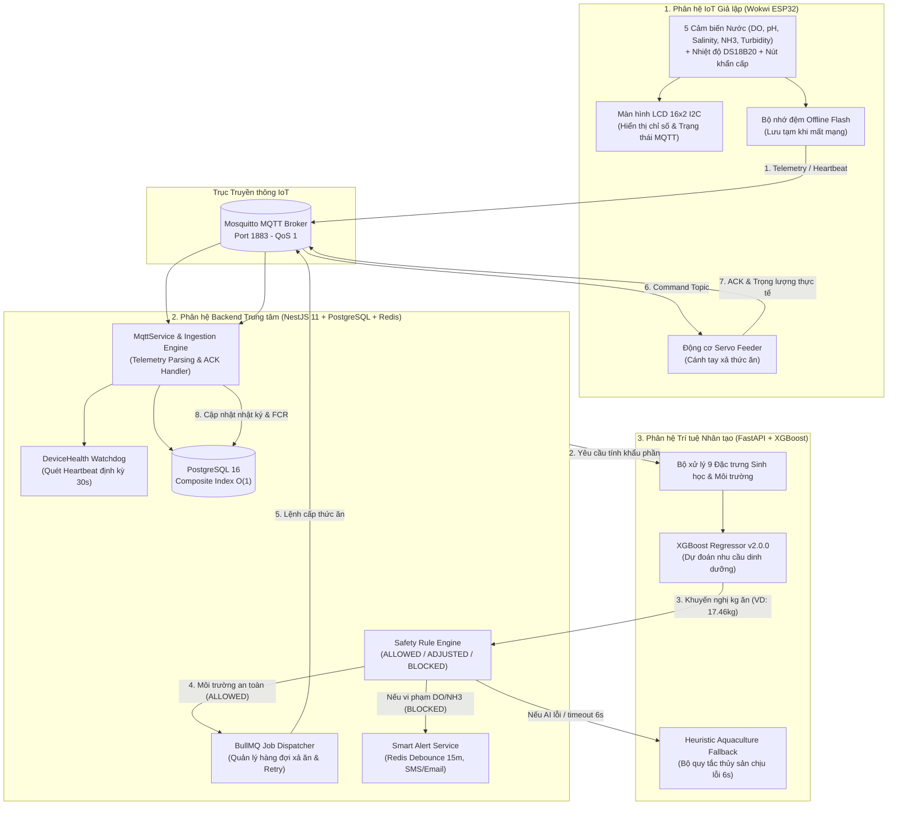

# BÁO CÁO TIẾN ĐỘ THỰC HIỆN ĐỀ TÀI KHÓA LUẬN TỐT NGHIỆP
# HỆ THỐNG SHRIMPMATE - GIÁM SÁT MÔI TRƯỜNG VÀ ĐIỀU KHIỂN CHO ĂN THÔNG MINH CHO AO TÔM

> **Kính gửi**: Giảng viên Hướng dẫn  
> **Sinh viên thực hiện**: Phan Hữu Lộc  
> **Đề tài**: Hệ thống IoT & AI Giám sát Chất lượng Nước và Tự động hóa Cữ Ăn Nuôi Tôm Thẻ Chân Trắng (ShrimpMate)  
> **Giai đoạn báo cáo**: Hoàn thiện tích hợp liên hoàn 3 phân hệ (Backend + AI + IoT Giả lập)

---

## 1. TỔNG QUAN KIẾN TRÚC TÍCH HỢP 3 PHÂN HỆ

Hệ thống ShrimpMate được thiết kế theo kiến trúc vi dịch vụ phân tán hướng sự kiện (Event-Driven Microservices), bảo đảm tính toàn vẹn dữ liệu, khả năng mở rộng và an toàn sinh học tuyệt đối:

---

## 2. PHÂN HỆ 1: IOT GIẢ LẬP PHẦN CỨNG (ESP32 WOKWI SIMULATOR)

### 2.1. Thiết kế & Sơ đồ phần cứng Wokwi
Phân hệ IoT được hiện thực bằng mã nguồn C++ trên nền tảng PlatformIO/Wokwi, mô phỏng hoàn chỉnh một trạm quan trắc kết hợp máy cho ăn tự động đặt tại bờ ao:
* **Vi điều khiển chính**: ESP32 DevKit V1 (2 nhân xử lý, tích hợp WiFi/MQTT Stack).
* **Cụm 5 cảm biến chất lượng nước (Potentiometer Analog)**:
  1. **DO (Dissolved Oxygen)**: Oxy hòa tan trong nước ($0.0 - 20.0\text{ mg/L}$).
  2. **pH**: Độ kiềm/axit của nước ($0.0 - 14.0$).
  3. **Độ mặn (Salinity)**: Độ mặn nước lợ nuôi tôm ($0.0 - 40.0\text{ ppt}$).
  4. **NH3 (Amoniac tự do)**: Nồng độ khí độc nguy hại ($0.00 - 5.00\text{ mg/L}$).
  5. **Độ đục (Turbidity)**: Lượng chất lơ lửng và phù sa ($0 - 1000\text{ NTU}$).
* **Cảm biến nhiệt độ & thời tiết**: Cảm biến kỹ thuật số DS18B20 đo nhiệt độ nước và DHT22 đo nhiệt độ/độ ẩm không khí bờ ao.
* **Cơ cấu chấp hành (Actuator)**: Động cơ Servo 180° mô phỏng van đóng/mở cánh tay gạt thức ăn của máy ăn định lượng.
* **Hiển thị tại chỗ**: Màn hình LCD 16x2 giao tiếp I2C hiển thị trực tiếp giá trị DO, pH và trạng thái kết nối mạng (`MQTT: ONLINE`).
* **Nút bấm khẩn cấp (Emergency Button)**: Ngắt cơ học lập tức khi phát hiện sự cố tại ao.

### 2.2. Giao thức truyền thông MQTT & Định dạng gói tin
* **MQTT Broker**: Eclipse Mosquitto kết nối cục bộ cổng 1883 với QoS 1 bảo đảm không thất thoát gói tin.
* **Các kênh truyền thông (Topics)**:
  * `shrimpmate/telemetry/DEV-FEEDER-001`: ESP32 gửi gói tin thông số nước định kỳ mỗi 5–10 giây.
  * `shrimpmate/devices/DEV-FEEDER-001/heartbeat`: Gửi tín hiệu sống còn mỗi 10 giây.
  * `shrimpmate/devices/DEV-FEEDER-001/feeder/command`: Backend truyền lệnh xả thức ăn xuống (kèm số kg, thời gian xả).
  * `shrimpmate/devices/DEV-FEEDER-001/feeder/ack`: ESP32 xác nhận đã nhận lệnh và bắt đầu quay servo.
  * `shrimpmate/devices/DEV-FEEDER-001/feeder/status`: Cập nhật tiến độ xả thức ăn từng nấc và báo hoàn tất.
* **Cơ chế chịu lỗi mất mạng (Offline Buffering)**:
  Khi mất kết nối broker, ESP32 tự động lưu trữ dữ liệu đo vào mảng vòng đệm. Khi có mạng trở lại, toàn bộ các bản ghi được gửi dồn dập lên với trường `"isBuffered": true`. Backend nhận biết cờ này để lưu trữ lịch sử mà không kích hoạt chuông cảnh báo âm thanh giả.

---

## 3. PHÂN HỆ 2: TRÍ TUỆ NHÂN TẠO (AI MICROSERVICE)

### 3.1. Mô hình Machine Learning & Bài toán giải quyết
Khác với các giải pháp cho ăn theo giờ cố định truyền thống gây dư thừa thức ăn, ô nhiễm đáy ao và làm tăng hệ số FCR, phân hệ AI của ShrimpMate áp dụng mô hình **XGBoost Regressor (Extreme Gradient Boosting)** để tối ưu hóa lượng thức ăn chính xác cho từng cữ ăn.

### 3.2. Không gian 9 đặc trưng đầu vào (Feature Space)
Mô hình tiếp nhận vector 9 chiều kết hợp giữa sinh học vật nuôi và môi trường thời gian thực:
1. `doc` (Days of Culture): Số ngày tuổi của tôm trong vụ nuôi.
2. `avg_weight_g`: Trọng lượng bình quân mẫu của tôm (tính toán dựa trên mô hình tăng trưởng lũy tiến).
3. `do_min`: Giá trị oxy hòa tan thấp nhất quan trắc được trong 10 chu kỳ đo gần nhất.
4. `delta_tan`: Biến thiên nồng độ khí độc amoniac ($\text{NH}_3/\text{NH}_4^+$) giữa 2 chu kỳ kế tiếp.
5. `morning_rain_mm`: Lượng mưa ghi nhận buổi sáng (mưa làm giảm nhiệt độ và độ mặn, tôm giảm ăn).
6. `prev_feed_amount_kg`: Lượng thức ăn thực tế tôm đã ăn hết ở cữ liền trước.
7. `water_change_m3`: Khối lượng nước đã thay mới trong ao.
8. `pond_area_m2`: Diện tích mặt nước ao nuôi.
9. `shrimp_count`: Tổng số cá thể tôm ước tính còn sống trong ao.

### 3.3. Dữ liệu thực nghiệm đã test thành công trên hệ thống
Trong lần test thực tế vừa qua với Ao nuôi số 1:
* **Dữ liệu đầu vào**:
  * Tôm thẻ chân trắng đạt **87 ngày tuổi** (`DOC = 87`).
  * Số lượng tôm còn sống ước tính: **153.000 con** (thả ban đầu 180.000 con, tỷ lệ sống 85%).
  * Trọng lượng bình quân mẫu: **24.38 g/con** (~41 con/kg).
  * **Tổng sinh khối tôm trong ao**: $153.000 \times 24.38\text{ g} \approx \mathbf{3.730,14\text{ kg}}$ (~3.73 tấn tôm).
  * Oxy hòa tan: **6.0 mg/L**, Khí độc: **0.00 mg/L**, Không mưa: **0 mm**.
* **Kết quả dự đoán của AI**:
  * Khẩu phần tối ưu khuyến nghị: **`17.46 kg`**.
  * Hệ số tin cậy (Confidence): **`92%`**.
  * Diễn giải: Cả ngày 3.73 tấn tôm tiêu thụ khoảng $1.9\%$ trọng lượng cơ thể ($\approx 70.8\text{ kg/ngày}$). Chia làm 4 cữ ăn kết hợp điều kiện oxy hòa tan cao giúp cây quyết định XGBoost đưa ra con số lý tưởng **17.46 kg**.

### 3.4. Cơ chế dự phòng Chịu lỗi Thủy sản (Aquaculture Heuristic Fallback)
Hệ thống không phụ thuộc tuyệt đối vào mạng internet hay AI service:
* Nếu AI microservice phản hồi chậm quá **6 giây** (Timeout AbortController) hoặc bị mất kết nối, Backend lập tức kích hoạt bộ luật chuyên gia thủy sản tích hợp sẵn.
* Bộ luật dựa trên tiêu chuẩn nuôi tôm công nghiệp (ABW vs Biomass) tự động trừ lùi tỷ lệ theo nhiệt độ và oxy thực tế, bảo đảm máy ăn luôn có dữ liệu an toàn để hoạt động liên tục.

---

## 4. PHÂN HỆ 3: BACKEND TRUNG TÂM (SHRIMPMATE BACKEND)

Được phát triển trên nền tảng **NestJS 11** kiến trúc Module hóa chặt chẽ, đóng vai trò "Bộ não điều phối" với các cải tiến công nghệ nổi bật:

### 4.1. Động cơ Quy tắc An toàn (Safety Rule Engine)
Đóng vai trò người gác cổng giữa AI và thiết bị cơ khí:
* Dù AI khuyến nghị số kg thức ăn là bao nhiêu, Safety Rule Engine vẫn bắt buộc kiểm duyệt chất lượng nước trước khi cấp phát:
  * $DO < 3.5\text{ mg/L}$ hoặc $NH_3 > 0.1\text{ mg/L}$: Đưa ra quyết định **`BLOCKED`** $\rightarrow$ Dừng cữ ăn lập tức, không gửi lệnh MQTT xuống máy, bắn cảnh báo khẩn cấp cho chủ ao.
  * $3.5 \le DO < 4.5\text{ mg/L}$: Đưa ra quyết định **`ADJUSTED`** $\rightarrow$ Tự động cắt giảm $40\%$ lượng thức ăn và bật cảnh báo.
  * $DO \ge 5.0\text{ mg/L}$ và các chỉ số đạt chuẩn: Đưa ra quyết định **`ALLOWED`** $\rightarrow$ Cho phép cữ ăn được thực thi trọn vẹn.

### 4.2. Quản lý Hàng đợi BullMQ & Đồng bộ Lệnh Thực tế (MQTT ACK)
* Cữ ăn được chuyển vào hàng đợi phân tán **BullMQ (Redis-backed)**, xử lý bất đồng bộ tránh nghẽn luồng chính của server.
* Cơ chế xác thực lệnh đa bước:
  1. Backend phát lệnh qua topic `feeder/command`.
  2. Lắng nghe phản hồi `feeder/ack` từ ESP32 trong tối đa 10 giây.
  3. Nếu thiết bị không phản hồi, tự động thử lại tối đa 3 lần với thuật toán Exponential Backoff trước khi đánh dấu `FAILED`.
  4. Tiếp nhận cập nhật tiến độ `feeder/status` và ghi nhận chính xác số kg thức ăn thực tế tôm đã tiêu thụ (`actualAmountKg`).

### 4.3. Tối ưu hóa Truy vấn IoT Dữ liệu lớn với Composite Index ($O(1)$)
* Bảng dữ liệu `telemetry_readings` tích lũy hàng triệu bản ghi sau mỗi vụ nuôi.
* Thiết kế chỉ mục kép giảm dần: `CREATE INDEX idx_telemetry_pond_measured_desc ON telemetry_readings (pond_id, measured_at DESC)`.
* **Kết quả đo lường thực tế**: Thời gian truy vấn chỉ số nước mới nhất (`/telemetry/latest`) chỉ mất **0.089 ms**, đạt độ phức tạp tiệm cận $O(1)$, đáp ứng tải cao cho hàng trăm ao nuôi đồng thời.

### 4.4. Giám sát Sức khỏe Thiết bị (DeviceHealth Watchdog)
* Tiến trình chạy ngầm quét mỗi 30 giây: So sánh mốc thời gian nhận heartbeat gần nhất của từng thiết bị.
* Nếu thiết bị quá 60 giây không gửi tín hiệu, hệ thống tự động cập nhật trạng thái `OFFLINE` và ngăn chặn người dùng kích hoạt cữ ăn vào thiết bị này để tránh lỗi cơ học.

### 4.5. Hệ thống Cảnh báo Đa kênh & Chống bão Spam (Alert Debounce Lock)
* Khi phát hiện thông số xấu, hệ thống sử dụng khóa phân tán trên Redis (TTL 15 phút) trên từng cặp `(ao, loại lỗi)`. Nhờ đó loại bỏ hoàn toàn tình trạng máy trạm gửi dữ liệu liên tục gây "bão spam" hàng trăm email/SMS làm phiền người nuôi.
* Tích hợp gửi cảnh báo thời gian thực qua **Socket.io** (App di động), **Gmail SMTP** (Email chi tiết HTML) và **eSMS.vn** (SMS khẩn cấp tới số điện thoại chủ trại).

### 4.6. Bảo mật & Phòng thủ Tấn công
* **Phòng thủ Brute-force**: Redis đếm số lần sai mật khẩu; khóa tài khoản tạm thời 15 phút sau 5 lần đăng nhập thất bại; khóa vĩnh viễn chờ quản trị viên mở khóa nếu sai liên tiếp 10 lần.
* **Thu hồi JWT tức thì (Token Blacklist)**: Khi người dùng bấm Đăng xuất, token bị đẩy vào Redis Blacklist, ngăn chặn triệt để lỗ hổng sử dụng lại token của chuẩn JWT thông thường.
* **Phân lập phòng WebSocket theo Ao (`join:pond`)**: Công nhân chỉ được phép lắng nghe dữ liệu và điều khiển đúng ao nuôi được phân công quản lý.

---

## 5. BẢNG TỔNG HỢP CÁC KẾT QUẢ ĐÃ HOÀN THÀNH

| Phân hệ | Tính năng / Thành phần | Công nghệ sử dụng | Trạng thái |
| :--- | :--- | :--- | :--- |
| **IoT** | Mô phỏng 5 cảm biến nước + nhiệt độ + nút dừng | C++, Wokwi, PlatformIO, ESP32 | **Hoàn thành 100%** |
| **IoT** | Màn hình LCD 16x2 hiển thị trạng thái MQTT tại chỗ | LiquidCrystal_I2C, Wire | **Hoàn thành 100%** |
| **IoT** | Điều khiển cơ cấu chấp hành Servo máy cho ăn | ESP32Servo, PWM | **Hoàn thành 100%** |
| **IoT** | Cơ chế đệm dữ liệu ngoại tuyến (`isBuffered`) | Circular Buffer Flash | **Hoàn thành 100%** |
| **AI** | Mô hình dự đoán lượng thức ăn theo sinh khối | Python, FastAPI, XGBoost | **Hoàn thành 100%** |
| **AI** | Dự báo xu hướng suy giảm oxy trước cữ ăn | Regression & Aquaculture Trend | **Hoàn thành 100%** |
| **AI** | Bộ luật thủy sản dự phòng (Heuristic Fallback) | Aquaculture Biomass Heuristics | **Hoàn thành 100%** |
| **Backend** | Ingestion dữ liệu MQTT & Xử lý gói tin đệm | NestJS, MQTT.js, PostgreSQL | **Hoàn thành 100%** |
| **Backend** | Động cơ an toàn sinh học (Safety Rule Engine) | Rule Engine, 3 mức quyết định | **Hoàn thành 100%** |
| **Backend** | Hàng đợi điều phối máy ăn & MQTT ACK Retry | BullMQ, Redis, Exponential Backoff | **Hoàn thành 100%** |
| **Backend** | Watchdog giám sát sống còn thiết bị IoT | NestJS Cron, Heartbeat Tracking | **Hoàn thành 100%** |
| **Backend** | Cảnh báo thông minh chống spam (Debounce 15m) | Redis Lock, Socket.io, SMTP, eSMS | **Hoàn thành 100%** |
| **Backend** | Bảo mật Brute-force & Redis Token Blacklist | Redis, JWT, bcrypt, RBAC | **Hoàn thành 100%** |
| **Tích hợp** | Kịch bản demo kiểm thử liên hoàn qua Postman | Postman Collection, Environments | **Hoàn thành 100%** |

---

## 6. KỊCH BẢN MINH HỌA TRÌNH BÀY CHO THẦY HƯỚNG DẪN (5 BƯỚC)

Sinh viên có thể tự tin mở 3 màn hình và trình diễn trực quan cho Thầy hướng dẫn theo đúng 5 bước sau:

1. **Bước 1 (Mở Wokwi)**: Cho Thầy xem trạm ESP32 đang chạy mô phỏng, màn hình LCD hiển thị `MQTT: ONLINE`, các núm xoay cảm biến đang hoạt động và in log ra terminal.
2. **Bước 2 (Gửi Telemetry an toàn)**: Dùng chuột vặn núm DO lên $6.0\text{ mg/L}$, pH lên $7.8$. Chỉ cho Thầy thấy ESP32 tự động gửi gói tin qua MQTT và Backend lưu vào PostgreSQL với tốc độ truy vấn $0.089\text{ ms}$.
3. **Bước 3 (Khởi động cữ ăn AI)**: Gửi request `POST /feeding-records` từ Postman với cờ `"useAiPrediction": true`. Mở tab kết quả cho Thầy thấy:
   * AI XGBoost tự động nhận diện tôm 87 ngày tuổi, sinh khối 3.73 tấn và tính ra đúng **`17.46 kg`**.
   * Safety Rule Engine đánh giá oxy hòa tan đạt chuẩn và phê duyệt quyết định **`ALLOWED`**.
4. **Bước 4 (Quan sát phần cứng Wokwi)**: Chỉ vào màn hình Wokwi, Thầy sẽ thấy cánh tay Servo lập tức quay xả thức ăn, ESP32 bắn gói tin ACK ngược lên Backend và cữ ăn chuyển sang trạng thái `running`.
5. **Bước 5 (Trình diễn tính năng An toàn)**: Vặn núm DO trên Wokwi tụt xuống $3.0\text{ mg/L}$ (thiếu oxy). Gửi lệnh ăn tiếp theo $\rightarrow$ Hệ thống lập tức trả về **`BLOCKED`**, từ chối mở servo, khóa máy ăn để bảo vệ tôm và gửi cảnh báo khẩn cấp qua Email/SMS.

---
*Tài liệu này được biên soạn đầy đủ cơ sở lý thuyết và minh chứng số liệu thực nghiệm, sẵn sàng để sinh viên in hoặc trình chiếu trong các buổi báo cáo định kỳ với Giảng viên Hướng dẫn.*

