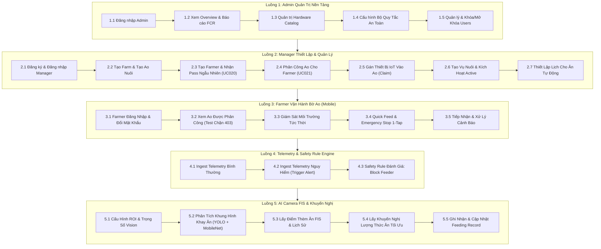

# ShrimpMate - Cẩm Nang Luồng Kiểm Thử Postman Toàn Diện (End-to-End Test Flows)

Tài liệu này cung cấp **5 Luồng Kiểm Thử Cốt Lõi** bao phủ 100% các tính năng nghiệp vụ của hệ thống ShrimpMate theo mô hình 3 Role:
- **Admin**: Quản trị nền tảng qua **Web Dashboard**
- **Manager**: Quản lý trang trại, vụ nuôi, lịch ăn & Farmer qua **Web App**
- **Farmer**: Giám sát ao nuôi & vận hành khẩn cấp qua **Mobile App**

---

## 1. Thiết Lập Môi Trường Postman (Environment Setup)

Tạo một **Environment** mới trên Postman tên là `ShrimpMate Local` với các biến sau:

| Tên biến | Giá trị khởi tạo | Mô tả |
|---|---|---|
| `baseUrl` | `http://localhost:3000` | Địa chỉ máy chủ Backend |
| `accessToken` | *(để trống)* | Tự động lưu Token của người dùng đang test |
| `adminToken` | *(để trống)* | Lưu token của Admin |
| `managerToken`| *(để trống)* | Lưu token của Manager |
| `farmerToken` | *(để trống)* | Lưu token của Farmer |
| `farmId` | *(để trống)* | ID Trang trại |
| `pondId` | *(để trống)* | ID Ao nuôi |
| `deviceId` | *(để trống)* | ID Thiết bị IoT |
| `farmerId` | *(để trống)* | ID Người nuôi |
| `cropSeasonId`| *(để trống)* | ID Vụ nuôi |
| `scheduleId` | *(để trống)* | ID Lịch cho ăn |
| `recordId` | *(để trống)* | ID Nhật ký cho ăn |
| `alertId` | *(để trống)* | ID Cảnh báo sự cố |

### Script Tự Động Lưu Token (Postman Test Script)
Trong Postman, tại tab **Tests** của request `POST /auth/login`, dán đoạn script sau:

```javascript
if (pm.response.code === 200) {
    const res = pm.response.json();
    if (res.accessToken) {
        pm.environment.set("accessToken", res.accessToken);
        if (res.user && res.user.role === 'admin') pm.environment.set("adminToken", res.accessToken);
        if (res.user && res.user.role === 'manager') pm.environment.set("managerToken", res.accessToken);
        if (res.user && res.user.role === 'farmer') pm.environment.set("farmerToken", res.accessToken);
        console.log("Đã lưu token cho role:", res.user ? res.user.role : 'user');
    }
}
```

---

## 2. Tài Khoản Seed Sẵn Có

| Role | Ứng dụng | Identifier (Email/SĐT) | Mật khẩu |
|---|---|---|---|
| `admin` | **Web Dashboard** | `admin@shrimpmate.local` / `0901000001` | `Admin@123456` |
| `manager` | **Web App** | `manager@shrimpmate.local` / `0901000002` | `Manager@123456` |
| `farmer` | **Mobile App** | `farmer@shrimpmate.local` / `0901000003` | `Farmer@123456` |

---

## 3. Sơ Đồ Tổng Quan 5 Luồng Kiểm Thử



---

# CHI TIẾT CÁC LUỒNG KIỂM THỬ

---

## LUỒNG 1: ADMIN QUẢN TRỊ NỀN TẢNG (WEB DASHBOARD)

### Bước 1.1: Đăng nhập tài khoản Admin
- **Method & URL**: `POST {{baseUrl}}/auth/login`
- **Body (raw JSON)**:
  ```json
  {
    "identifier": "admin@shrimpmate.local",
    "password": "Admin@123456"
  }
  ```
- **Kỳ vọng**: `200 OK`, `user.role: "admin"`. Biến `{{accessToken}}` được cập nhật token Admin.

### Bước 1.2: Xem tổng quan hệ thống & Báo cáo FCR
- **1.2.1 Tổng quan**: `GET {{baseUrl}}/admin/overview` (Bearer `{{accessToken}}`) -> `200 OK` (thống kê tổng user, farm, pond, device, alerts).
- **1.2.2 Báo cáo FCR**: `GET {{baseUrl}}/admin/reports/system-fcr` -> `200 OK` (chỉ số FCR trung bình toàn hệ thống).
- **1.2.3 Báo cáo Trang trại**: `GET {{baseUrl}}/admin/reports/farms` -> `200 OK`.

### Bước 1.3: Quản trị Hardware Catalog (Thiết bị IoT)
- **1.3.1 Xem danh mục thiết bị**: `GET {{baseUrl}}/devices` -> `200 OK`.
- **1.3.2 Khai báo thiết bị mới vào catalog**:
  - **Method & URL**: `POST {{baseUrl}}/devices`
  - **Body (raw JSON)**:
    ```json
    {
      "deviceUid": "DEV-FEEDER-003",
      "name": "Máy cho ăn dự phòng 03",
      "type": "feeder",
      "status": "online",
      "mode": "automatic",
      "firmwareVersion": "1.0.0",
      "metadata": {
        "zone": "khu_du_phong"
      }
    }
    ```
  - **Kỳ vọng**: `201 Created` (thiết bị được lưu vào catalog ở trạng thái tự do `pondId: null`).

### Bước 1.4: Cấu hình Bộ Quy Tắc An Toàn (Safety Rules)
- **1.4.1 Xem danh sách quy tắc**: `GET {{baseUrl}}/safety-rules` -> `200 OK`.
- **1.4.2 Tạo quy tắc an toàn mới**:
  - **Method & URL**: `POST {{baseUrl}}/safety-rules`
  - **Body (raw JSON)**:
    ```json
    {
      "code": "RULE_LOW_DO_BLOCK",
      "name": "Chặn cho ăn khi oxy hòa tan dưới 3.5 mg/L",
      "priority": 10,
      "isEnabled": true,
      "condition": {
        "parameter": "dissolvedOxygenMgL",
        "operator": "<",
        "threshold": 3.5
      },
      "action": {
        "type": "block_feed",
        "message": "Hàm lượng Oxy hòa tan quá thấp, có nguy cơ gây sốc tôm"
      }
    }
    ```
  - **Kỳ vọng**: `201 Created`.

### Bước 1.5: Quản lý người dùng & Khóa tài khoản
- **1.5.1 Xem tất cả tài khoản**: `GET {{baseUrl}}/auth/users` -> `200 OK`.
- **1.5.2 Khóa tài khoản khi có vi phạm**: `PATCH {{baseUrl}}/auth/users/<userId>/status`
  ```json
  {
    "isActive": false
  }
  ```

---

## LUỒNG 2: MANAGER THIẾT LẬP & QUẢN LÝ (WEB APP)

### Bước 2.1: Đăng ký & Đăng nhập Manager
- **2.1.1 Manager tự đăng ký**:
  - **Method & URL**: `POST {{baseUrl}}/auth/register`
  - **Body (raw JSON)**:
    ```json
    {
      "fullName": "Trần Quản Lý",
      "phoneNumber": "0981112233",
      "email": "manager_baclieu@shrimpmate.local",
      "password": "Password@123"
    }
    ```
  - **Kỳ vọng**: `201 Created`, vai trò mặc định là `manager`.
- **2.1.2 Đăng nhập**: `POST {{baseUrl}}/auth/login`
  ```json
  {
    "identifier": "manager_baclieu@shrimpmate.local",
    "password": "Password@123"
  }
  ```
  *(Lưu token vào biến `{{managerToken}}` và `{{accessToken}}`).*

### Bước 2.2: Tạo Trang trại & Ao nuôi
- **2.2.1 Tạo Trang trại**:
  - **Method & URL**: `POST {{baseUrl}}/farms`
  - **Body (raw JSON)**:
    ```json
    {
      "name": "Trang Trại Sóc Trăng Xanh",
      "address": "Mỹ Xuyên, Sóc Trăng",
      "status": "active"
    }
    ```
  - **Kỳ vọng**: `201 Created`. **Lưu `id` vào biến `{{farmId}}`**.
- **2.2.2 Tạo Ao nuôi**:
  - **Method & URL**: `POST {{baseUrl}}/farms/{{farmId}}/ponds`
  - **Body (raw JSON)**:
    ```json
    {
      "code": "POND-01",
      "name": "Ao Nuôi Tôm Thẻ Số 1",
      "areaM2": 2500,
      "status": "active"
    }
    ```
  - **Kỳ vọng**: `201 Created`. **Lưu `id` vào biến `{{pondId}}`**.

### Bước 2.3: Tạo tài khoản Farmer (UC020)
- **Method & URL**: `POST {{baseUrl}}/farmers`
- **Header**: `Authorization: Bearer {{managerToken}}`
- **Body (raw JSON)**:
  ```json
  {
    "fullName": "Nguyễn Văn Nuôi Tôm",
    "phoneNumber": "0977889900",
    "email": "farmer_ba@shrimpmate.local"
  }
  ```
- **Kỳ vọng**: `201 Created`. Response trả về:
  - `farmer.id` -> **Lưu vào biến `{{farmerId}}`**.
  - `temporaryPassword` (mật khẩu ngẫu nhiên dạng `Fm#k9xP!2a`, lưu lại để Farmer đăng nhập).

### Bước 2.4: Phân công Ao cho Farmer (UC021)
- **Method & URL**: `POST {{baseUrl}}/farmers/assignments`
- **Header**: `Authorization: Bearer {{managerToken}}`
- **Body (raw JSON)**:
  ```json
  {
    "farmerId": "{{farmerId}}",
    "farmId": "{{farmId}}",
    "pondId": "{{pondId}}"
  }
  ```
- **Kỳ vọng**: `201 Created`.
- **Xem danh sách phân công**: `GET {{baseUrl}}/farmers/assignments/list` -> `200 OK`.

### Bước 2.5: Gán thiết bị IoT vào Ao (Claim Device)
- **Method & URL**: `POST {{baseUrl}}/devices/claim`
- **Header**: `Authorization: Bearer {{managerToken}}`
- **Body (raw JSON)**:
  ```json
  {
    "deviceUid": "DEV-FEEDER-002",
    "pondId": "{{pondId}}"
  }
  ```
- **Kỳ vọng**: `200 OK` (gán thành công máy cho ăn `DEV-FEEDER-002` vào `{{pondId}}`). **Lưu `id` thiết bị vào `{{deviceId}}`**.

### Bước 2.6: Khởi tạo Vụ nuôi mới & Kích hoạt
- **2.6.1 Tạo Vụ nuôi**:
  - **Method & URL**: `POST {{baseUrl}}/ponds/{{pondId}}/crop-seasons`
  - **Body (raw JSON)**:
    ```json
    {
      "name": "Vụ Mùa Mưa 2026",
      "stockingDate": "2026-10-10",
      "initialCount": 80000,
      "stockingDensity": 32.0,
      "initialAverageWeightG": 0.8,
      "estimatedSurvivalRate": 85.0,
      "status": "planned"
    }
    ```
  - **Kỳ vọng**: `201 Created`. **Lưu `id` vào `{{cropSeasonId}}`**.
- **2.6.2 Kích hoạt vụ nuôi**:
  - **Method & URL**: `PATCH {{baseUrl}}/crop-seasons/{{cropSeasonId}}`
  - **Body (raw JSON)**:
    ```json
    {
      "status": "active"
    }
    ```
  - **Kỳ vọng**: `200 OK`.

### Bước 2.7: Cài đặt Lịch cho ăn tự động
- **Method & URL**: `POST {{baseUrl}}/ponds/{{pondId}}/feeding-schedules`
- **Header**: `Authorization: Bearer {{managerToken}}`
- **Body (raw JSON)**:
  ```json
  {
    "name": "Cữ cho ăn sáng",
    "timeOfDay": "07:30",
    "feedAmountKg": 12.5,
    "spreadRateKgPerMinute": 1.5,
    "daysOfWeek": [1, 2, 3, 4, 5, 6, 0],
    "isEnabled": true
  }
  ```
  *(Ghi chú: `daysOfWeek`: 0 là Chủ Nhật, 1 đến 6 là Thứ Hai đến Thứ Bảy).*
- **Kỳ vọng**: `201 Created`. **Lưu `id` vào `{{scheduleId}}`**.

---

## LUỒNG 3: FARMER VẬN HÀNH BỜ AO (MOBILE APP)

### Bước 3.1: Farmer đăng nhập & Đổi mật khẩu
- **3.1.1 Đăng nhập bằng mật khẩu tạm**:
  - **Method & URL**: `POST {{baseUrl}}/auth/login`
  - **Body (raw JSON)**:
    ```json
    {
      "identifier": "0977889900",
      "password": "<temporaryPassword nhận được ở Bước 2.3>"
    }
    ```
  - **Kỳ vọng**: `200 OK`, `user.role: "farmer"`. **Lưu token vào `{{farmerToken}}`**.
- **3.1.2 Đổi mật khẩu**:
  - **Method & URL**: `PATCH {{baseUrl}}/auth/change-password`
  - **Header**: `Authorization: Bearer {{farmerToken}}`
  - **Body (raw JSON)**:
    ```json
    {
      "currentPassword": "<temporaryPassword>",
      "newPassword": "Farmer@NewPass123"
    }
    ```
  - **Kỳ vọng**: `200 OK`.

### Bước 3.2: Kiểm tra phân quyền truy cập Ao (Data Isolation)
- **3.2.1 Xem danh sách ao được phân công**:
  - **Method & URL**: `GET {{baseUrl}}/ponds` (Header: Bearer `{{farmerToken}}`)
  - **Kỳ vọng**: `200 OK`. Farmer **CHỈ thấy duy nhất Ao nuôi** đã được Manager phân công ở Bước 2.4.
- **3.2.2 Thử truy cập ao của người khác (Security Test)**:
  - **Method & URL**: `GET {{baseUrl}}/ponds/208cf3b7-a60f-4c83-83b0-54d06fee3d97`
  - **Kỳ vọng**: **`403 Forbidden`** (*"Bạn không có quyền truy cập ao nuôi này"*).

### Bước 3.3: Giám sát môi trường tức thời tại bờ ao
- **3.3.1 Xem gauges tức thời**: `GET {{baseUrl}}/ponds/{{pondId}}/telemetry/latest` -> `200 OK`.
- **3.3.2 Xem lịch sử đo chuỗi thời gian**: `GET {{baseUrl}}/ponds/{{pondId}}/telemetry/history?range=24h&metric=ph` -> `200 OK`.

### Bước 3.4: Điều khiển máy cho ăn 1-Tap
- **3.4.1 Cho ăn nhanh (Quick Feed 1-Tap)**:
  - **Method & URL**: `POST {{baseUrl}}/devices/{{deviceId}}/quick-feed`
  - **Header**: `Authorization: Bearer {{farmerToken}}`
  - **Body (raw JSON)**:
    ```json
    {
      "feedAmountKg": 2.5,
      "dispenseDurationSec": 30
    }
    ```
  - **Kỳ vọng**: `200 OK`. Lệnh được đẩy xuống phần cứng qua MQTT topic `shrimpmate/devices/DEV-FEEDER-002/commands`.
- **3.4.2 Dừng khẩn cấp (Emergency Stop 1-Tap)**:
  - **Method & URL**: `POST {{baseUrl}}/devices/{{deviceId}}/emergency-stop`
  - **Header**: `Authorization: Bearer {{farmerToken}}`
  - **Body (raw JSON)**:
    ```json
    {
      "reason": "Phát hiện tôm không vào nhá ăn ngoài bờ ao"
    }
    ```
  - **Kỳ vọng**: `200 OK`. Chế độ chuyển thành `emergency_stop` tức thì.

### Bước 3.5: Tiếp nhận & Xử lý cảnh báo sự cố
- **3.5.1 Lấy danh sách cảnh báo của ao**: `GET {{baseUrl}}/ponds/{{pondId}}/alerts` -> `200 OK`. Lưu `id` cảnh báo vào `{{alertId}}`.
- **3.5.2 Xác nhận đã tiếp nhận sự cố**: `PATCH {{baseUrl}}/alerts/{{alertId}}/acknowledge` -> `200 OK` (`status: "acknowledged"`).
- **3.5.3 Xác nhận đã khắc phục xong**: `PATCH {{baseUrl}}/alerts/{{alertId}}/resolve` -> `200 OK` (`status: "resolved"`).

---

## LUỒNG 4: GIÁM SÁT MÔI TRƯỜNG & SAFETY ENGINE

### Bước 4.1: Mô phỏng nạp chỉ số môi trường bình thường
- **Method & URL**: `POST {{baseUrl}}/ponds/{{pondId}}/telemetry`
- **Header**: `Authorization: Bearer {{managerToken}}`
- **Body (raw JSON)**:
  ```json
  {
    "deviceId": "{{deviceId}}",
    "ph": 7.8,
    "dissolvedOxygenMgL": 5.8,
    "temperatureC": 28.5,
    "salinityPpt": 15.0,
    "ammoniaMgL": 0.05,
    "turbidityNtu": 35.0
  }
  ```
- **Kỳ vọng**: `201 Created`.

### Bước 4.2: Mô phỏng chỉ số nước NGUY HIỂM (Kích hoạt Incident Alert)
- **Method & URL**: `POST {{baseUrl}}/ponds/{{pondId}}/telemetry`
- **Body (raw JSON)**:
  ```json
  {
    "deviceId": "{{deviceId}}",
    "ph": 6.2,
    "dissolvedOxygenMgL": 2.5,
    "temperatureC": 34.2,
    "salinityPpt": 15.0,
    "ammoniaMgL": 0.85,
    "turbidityNtu": 120.0
  }
  ```
- **Kỳ vọng**: `201 Created`.
  - Backend tự động sinh cảnh báo mức độ **`CRITICAL`** cho `dissolvedOxygenMgL` (< 3.5 mg/L).
  - Áp dụng cơ chế anti-spam debounce window 15 phút.

### Bước 4.3: Đánh giá an toàn trước cữ ăn (Pre-Feeding Safety Evaluation)
- **Method & URL**: `POST {{baseUrl}}/ponds/{{pondId}}/safety-rules/evaluate`
- **Body (raw JSON)**:
  ```json
  {
    "deviceId": "{{deviceId}}",
    "requestedAmountKg": 10.0
  }
  ```
- **Kỳ vọng**: `200 OK`.
  ```json
  {
    "decision": "blocked",
    "passed": false,
    "reason": "Chặn cho ăn khi oxy hòa tan dưới 3.5 mg/L",
    "evaluatedAt": "2026-10-10T15:00:00.000Z"
  }
  ```
  *(Feeder bị khóa, ngăn chặn thức ăn thừa làm ô nhiễm ao).*

---

## LUỒNG 5: TRÍ TUỆ NHÂN TẠO AI & THỊ GIÁC MÁY TÍNH

### Bước 5.1: Cấu hình ROI khay ăn & Trọng số FIS
- **5.1.1 Cập nhật vùng ROI khay ăn**:
  - **Method & URL**: `PATCH {{baseUrl}}/camera/devices/{{deviceId}}/roi`
  - **Header**: `Authorization: Bearer {{managerToken}}`
  - **Body (raw JSON)**:
    ```json
    {
      "roiPolygon": [
        {"x": 100, "y": 150},
        {"x": 500, "y": 150},
        {"x": 500, "y": 550},
        {"x": 100, "y": 550}
      ]
    }
    ```
  - **Kỳ vọng**: `200 OK`.
- **5.1.2 Tinh chỉnh trọng số thuật toán FIS**:
  - **Method & URL**: `PATCH {{baseUrl}}/camera/ponds/{{pondId}}/weights`
  - **Body (raw JSON)**:
    ```json
    {
      "w1": 0.35,
      "w2": 0.25,
      "w3": 0.25,
      "w4": 0.15,
      "q25": 25.0,
      "q50": 50.0,
      "q75": 75.0
    }
    ```
  - **Kỳ vọng**: `200 OK`.

### Bước 5.2: Phân tích khung hình khay ăn (Dual AI Pipeline)
- **Method & URL**: `POST {{baseUrl}}/camera/analyze`
- **Header**: `Authorization: Bearer {{managerToken}}`
- **Body (raw JSON)**:
  ```json
  {
    "deviceId": "{{deviceId}}",
    "imageUrl": "https://shrimpmate.storage/samples/tray_frame_01.jpg"
  }
  ```
- **Kỳ vọng**: `200 OK`. Trả về:
  - `fisScore`: Điểm thèm ăn (ví dụ: `78.5`).
  - `appetiteLevel`: Mức độ thèm ăn (`0: None`, `1: Weak`, `2: Normal`, `3: Strong`).
  - `shrimpCount`: Số lượng tôm phát hiện quanh sàng.
  - `residualFeedPercent`: Tỷ lệ thức ăn thừa trên khay.

### Bước 5.3: Xem chỉ số thèm ăn FIS & Lịch sử
- **5.3.1 FIS tức thời**: `GET {{baseUrl}}/camera/ponds/{{pondId}}/latest-fis` -> `200 OK`.
- **5.3.2 Lịch sử chuỗi thời gian FIS**: `GET {{baseUrl}}/camera/ponds/{{pondId}}/fis-history?range=24h` -> `200 OK`.

### Bước 5.4: Khai thác khuyến nghị dinh dưỡng tối ưu từ AI
- **5.4.1 Khuyến nghị thức ăn**: `GET {{baseUrl}}/ai-integration/ponds/{{pondId}}/feed-recommendation` -> `200 OK`.
  - Trả về lượng thức ăn tối ưu đề xuất dựa trên sinh khối tôm và điểm thèm ăn FIS.
- **5.4.2 Ước tính sinh khối ao**: `GET {{baseUrl}}/ai-integration/ponds/{{pondId}}/biomass` -> `200 OK`.

### Bước 5.5: Tạo và cập nhật nhật ký cho ăn (Feeding Records)
- **5.5.1 Tạo bản ghi cữ ăn**:
  - **Method & URL**: `POST {{baseUrl}}/ponds/{{pondId}}/feeding-records`
  - **Body (raw JSON)**:
    ```json
    {
      "deviceId": "{{deviceId}}",
      "scheduleId": "{{scheduleId}}",
      "requestedAmountKg": 12.5,
      "actualAmountKg": 12.0,
      "source": "schedule",
      "status": "running"
    }
    ```
  - **Kỳ vọng**: `201 Created`. **Lưu `id` vào `{{recordId}}`**.
- **5.5.2 Cập nhật hoàn tất cữ ăn**:
  - **Method & URL**: `PATCH {{baseUrl}}/feeding-records/{{recordId}}`
  - **Body (raw JSON)**:
    ```json
    {
      "status": "completed",
      "actualAmountKg": 12.0,
      "appetiteLevel": 2,
      "leftoverPercent": 3.5
    }
    ```
  - **Kỳ vọng**: `200 OK`.
